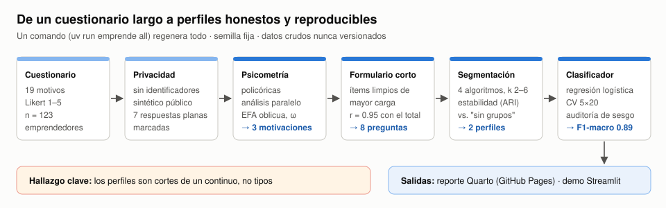

# Perfiles motivacionales de emprendedores

[](https://github.com/tcarmona0108/perfiles-motivacionales-emprendedores/actions/workflows/ci.yml)

**[📄 Reporte técnico](https://tcarmona0108.github.io/perfiles-motivacionales-emprendedores/)** · **[🧭 Demo "Descubre tu perfil emprendedor"](https://perfiles-motivacionales-emprendedores-ghv2zpyfalwitmfntdbmhh.streamlit.app/)** · **[Diagnóstico del trabajo original](docs/diagnostico.md)**



## El problema

Una investigación aplicó un cuestionario de **19 motivos para emprender** a 123 personas
que ya emprenden. El objetivo era estimar el perfil emprendedor de alguien y apoyar la
decisión de invertir en esa persona. No existe una etiqueta de quién "es" un emprendedor
exitoso, así que el problema es **no supervisado**: hay que descubrir qué mide el
cuestionario, cuántas preguntas bastan y si las personas forman grupos con perfiles distintos.

Este repositorio es la **versión 2** de ese análisis: reproducible, con decisiones
metodológicas justificadas y con un resultado que no afirma más de lo que los datos permiten.
El trabajo original se conserva en [`legacy/`](legacy/) para comparar el antes y el después.

## Enfoque

1. **Preparación:** se eliminan los cuasi-identificadores (ciudad, descripción del negocio) en
   cuanto se leen los datos. Se marcan las respuestas planas y se mide el efecto techo.
2. **Psicometría:** correlaciones **policóricas** (ítems ordinales), número de factores por
   **análisis paralelo** (criterio fijado antes de ver los datos), **análisis factorial
   exploratorio** con rotación oblicua y confiabilidad con **ω de McDonald**. La estabilidad
   se mide por bootstrap.
3. **Cuestionario corto:** por factor se eligen las preguntas de mayor carga que miden un solo
   factor, y se compara la versión corta con la larga.
4. **Segmentación:** K-means, Ward, mezclas gaussianas y *Latent Profile Analysis*, con k de 2
   a 6. Se eligen por **estabilidad** en submuestras y se contrastan con datos simulados **sin grupos**.
5. **Formulario:** una regresión logística predice el perfil a partir de las preguntas cortas,
   evaluada con validación cruzada 5×20 frente a una línea base.
6. **Ética:** los atributos sensibles nunca entran a un modelo; se audita después si los perfiles
   quedan desbalanceados por ellos.

## Resultados principales

- **3 motivaciones**: *Recursos y entorno de apoyo* (ω = 0.87), *Autonomía y autorrealización*
  (ω = 0.90) y *Oportunidad e innovación* (ω = 0.73, **tentativa**: solo 2 ítems, poco estable).
  Los 5 factores del análisis original no se sostienen de forma estable.
- **8 preguntas bastan** de 19: el puntaje total corto correlaciona **r = 0.95** con el completo.
- **No hay grupos naturales:** la única segmentación estable (ARI 0.91) separa *motivación
  moderada* (50) de *motivación alta* (66). Su silueta no supera la de datos sin grupos (p = 0.12):
  son **cortes de un continuo**, útiles para comunicar, no tipos de personas.
- **El formulario reproduce el perfil** con F1-macro **0.89** (línea base 0.36). La "exactitud
  del 97 %" del análisis original era circular y se retiró.
- **Sesgo:** los perfiles usados no muestran desbalance por género, edad, estado civil ni
  educación. Una segmentación alternativa por "tipo de motivación" sí lo mostraba (70 % hombres
  en un perfil) y por eso se descartó.

## Stack

Python 3.12 · pandas · NumPy · SciPy · scikit-learn · factor_analyzer · statsmodels ·
matplotlib · **uv** (dependencias fijadas) · **ruff** · **pytest** · **GitHub Actions** ·
**Quarto** (reporte) · **Streamlit** + Plotly (demo)

## Cómo reproducir

Requisitos: [uv](https://docs.astral.sh/uv/) y [Quarto](https://quarto.org) (este último solo
para el reporte).

```bash
git clone https://github.com/tcarmona0108/perfiles-motivacionales-emprendedores.git && cd perfiles-motivacionales-emprendedores
uv sync --locked
uv run emprende all
```

- Sin argumentos, el pipeline usa los **datos sintéticos** versionados
  ([cómo se generaron](data/synthetic/FICHA.md)). Con los datos reales en `data/raw/` (no
  versionados): `uv run emprende all --fuente real`. La corrida completa tarda unos 18 minutos y
  dos corridas desde cero producen tablas idénticas byte a byte.
- Pasos sueltos: `uv run emprende <paso>` (`datos`, `psicometria`, `segmentacion`, `modelo`,
  `figuras`, `reporte`, …). En Linux y macOS también funcionan `make all` y `make test`.
- La demo, en local: `uv run streamlit run app/streamlit_app.py`.
- Todos los parámetros (semilla, umbrales, k candidatos) están en [`config.yaml`](config.yaml).

## Estructura

```
├── config.yaml              parámetros del análisis (un solo lugar)
├── src/emprendimiento/      paquete: datos, correlaciones, psicometria, reduccion,
│                            segmentacion, perfiles, modelo, sesgo, visualizacion, pipeline, cli
├── tests/                   51 tests (métodos validados con datos de estructura conocida)
├── data/synthetic/          dataset sintético público + ficha
├── data/raw/                datos reales (NO versionados)
├── results/real/            resultados AGREGADOS publicados (tablas, figuras, modelo de la demo)
├── reports/                 reporte Quarto → GitHub Pages
├── app/                     demo Streamlit (solo lee results/real)
├── docs/                    diagnóstico del trabajo original y resultados de la Fase 2
├── legacy/                  notebook y README originales (outputs con datos personales retirados)
└── scripts/                 auditoría de privacidad y saneamiento del notebook legado
```

## Limitaciones

- **No hay variable de resultado** (ventas, supervivencia, financiación): ningún perfil
  indica "potencial" ni predice éxito.
- **Solo emprendedores**, n = 116 válidos, muestra no probabilística.
- La tercera motivación es tentativa y los perfiles son cortes de un continuo.
- Motivaciones **declaradas**, con fuerte efecto techo.
- La herramienta es un **apoyo para conversar**, no una decisión automática sobre personas.
- Pendiente de confirmar: el texto exacto de los ítems y las anclas de la escala.

## Créditos

- **Investigación de origen y datos:** Profesora Flor Angela Marulanda.
- **Análisis original (v1):** apoyo estadístico a la investigación ([`legacy/`](legacy/)).
- **Versión 2 (análisis reproducible, reporte y demo):** Tomás Carmona, Maestría en Analítica,
  Universidad Nacional de Colombia.

Los datos crudos pertenecen a la investigación de origen y no se distribuyen.

## Para portafolio y LinkedIn

> Reestructuré el análisis de un cuestionario sobre motivaciones para emprender (n = 123) en
> un pipeline reproducible en Python. Con correlaciones policóricas y análisis factorial
> identifiqué 3 motivaciones y reduje el cuestionario de 19 a 8 preguntas (r = 0.95 con el
> puntaje completo). Una segmentación validada por estabilidad mostró que los perfiles son
> cortes de un continuo, no tipos naturales. Un clasificador interpretable los reproduce con
> F1-macro 0.89. Incluye auditoría de sesgo, datos sintéticos para proteger la privacidad,
> CI, reporte en Quarto y demo en Streamlit.
